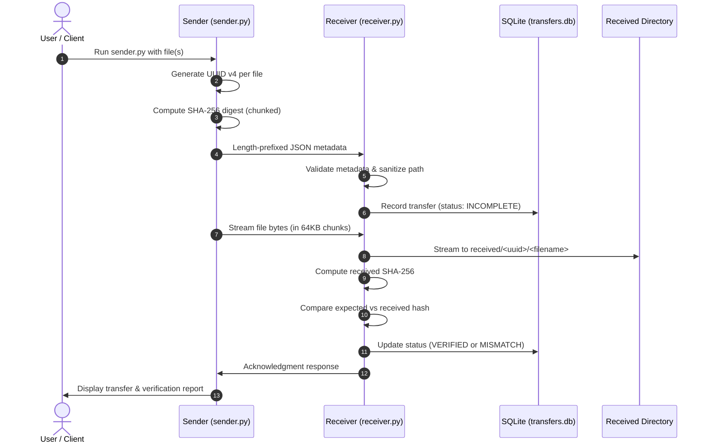

# Secure Network File Transfer with Sender, Receiver & Hash Checker

A Python TCP networking application for secure, reliable file transfer with SHA-256 integrity verification, duplicate filename collision avoidance via UUID directory isolation, SQLite transfer history tracking, and automatic/manual hash audits.

---

## Architecture and Workflow



---

## Key Features

1. **Duplicate Filename Strategy**:
   - Filenames are never used as unique keys.
   - Each transfer receives a dedicated UUID v4.
   - Files are stored as `received/<uuid>/<original_filename>`.
   - Multiple transfers sharing the same filename (e.g. `report.pdf`) never overwrite each other and maintain separate verification records in SQLite.
2. **Chunked SHA-256 Hashing**:
   - Hashing is performed in 64 KB streaming chunks via `hash_utils.py`.
   - Arbitrarily large files can be transferred without memory exhaustion.
   - Supports 0-byte empty files (`e3b0c44...`).
3. **Robust TCP Framing & Reliable Reads**:
   - `protocol.py` implements 4-byte big-endian framing (`!I`) for metadata JSON.
   - `recv_exact` guarantees exact byte counts despite TCP stream packet fragmentation.
4. **SQLite Transfer Auditing**:
   - `storage.py` tracks transfer UUID, original filename, file size, sender hash, receiver hash, stored path, timestamps, and status (`VERIFIED`, `MISMATCH`, `FAILED`, `INCOMPLETE`).
5. **Interactive & Manual Hash Checker**:
   - Automatic verification immediately upon file receipt.
   - `hash_checker.py verify <uuid>` re-verifies stored files on disk.
   - `hash_checker.py verify-all` audits entire transfer history for bitrot or file tampering.
   - `hash_checker.py check-file` independently hashes arbitrary local files.
   - `hash_checker.py list` displays full transfer history.
6. **Security & Protection**:
   - Path traversal prevention (`../../` or absolute paths are strictly sanitized to basenames).
   - Maximum file size and metadata size enforcement.
   - Shared token authentication (`auth_token`).
   - Optional end-to-end TLS encryption support.
   - Partial or interrupted transfers are safely renamed to `.incomplete` and recorded as `FAILED`, never marked `VERIFIED`.

---

## Folder Structure

```
c:/Users/user/Downloads/hash_checker/
├── config.py                 # Central configuration and defaults
├── hash_utils.py             # Chunked SHA-256 calculation & incremental hasher
├── protocol.py               # Framing, recv_exact, JSON metadata, and path sanitization
├── storage.py                # SQLite database interface (data/transfers.db)
├── receiver.py               # TCP receiver server with auto-verification
├── sender.py                 # TCP client with streaming progress and hash computation
├── hash_checker.py           # CLI verification and audit utility
├── generate_certs.py         # Utility to generate self-signed TLS certificates
├── requirements.txt          # Python requirements / test dependencies
├── README.md                 # Project documentation
├── sender_files/             # Sample test files to send
├── received/                 # Received files isolated by UUID
├── data/                     # SQLite database (transfers.db) and TLS certs
├── logs/                     # System log file (transfer.log)
└── tests/                    # 22 automated unit and integration tests
```

---

## Installation & Requirements

The core application runs on Python 3.8+ using the standard library.

Install testing dependencies:
```bash
pip install -r requirements.txt
```

---

## Quickstart & CLI Usage

### Option A: Launch the Interactive Web Dashboard (Recommended)
Launch the modern browser interface with drag-and-drop file upload, live progress, real-time audit tables, and tamper testing:
```bash
python web_app.py
```
Open **`http://127.0.0.1:5000`** in your browser.

---

### Option B: Command Line (CLI) Workflow

#### 1. Start the Receiver Server
Listen on default host `127.0.0.1` and port `9999`:
```bash
python receiver.py
```
Options:
- `--host <ip>`: Bind IP (default: `127.0.0.1`)
- `--port <port>`: Port to listen on (default: `9999`)
- `--save-dir <path>`: Destination directory (default: `received`)
- `--token <token>`: Custom authentication token
- `--once`: Exit after receiving one transfer
- `--tls`: Enable TLS encryption (requires `--cert` and `--key`)

### 2. Send Files with Sender Client
Send a single file:
```bash
python sender.py sender_files/report.pdf
```

Send multiple files in batch:
```bash
python sender.py sender_files/notes.txt sender_files/report.pdf
```

Options:
- `--host <ip>`: Target host (default: `127.0.0.1`)
- `--port <port>`: Target port (default: `9999`)
- `--token <token>`: Authentication token
- `--tls`: Enable TLS encryption
- `--quiet`: Suppress progress output

### 3. Check and Audit Transfers with Hash Checker

**View transfer history:**
```bash
python hash_checker.py list
```

**Re-verify a received file by its Transfer ID:**
```bash
python hash_checker.py verify <transfer_id>
```

**Audit all received files on disk against their expected hashes:**
```bash
python hash_checker.py verify-all
```

**Calculate and verify hash of any local file:**
```bash
python hash_checker.py check-file <filepath> <expected_sha256>
```

---

## TLS Encrypted File Transfer

Generate self-signed certificate and private key:
```bash
python generate_certs.py
```

Run receiver with TLS:
```bash
python receiver.py --tls --cert data/server.crt --key data/server.key
```

Run sender with TLS:
```bash
python sender.py sender_files/report.pdf --tls --ca-cert data/server.crt
```

---

## Running the Automated Test Suite

Run the full pytest suite:
```bash
python -m pytest tests/ -v
```

All 22 test cases verify:
- Chunked hashing for empty, small, and multi-megabyte files
- Protocol framing, `recv_exact` stream fragmentation, and boundary tests
- Duplicate filename isolation under `received/<uuid>/<filename>`
- Normal end-to-end transfers with SHA-256 match
- Tampered/corrupted file detection (`MISMATCH`)
- Connection drops and partial transfer marking (`FAILED`)
- Directory traversal attacks and path sanitization
- Shared token authentication rejection
- File size limit enforcement
- TLS encrypted transfers
