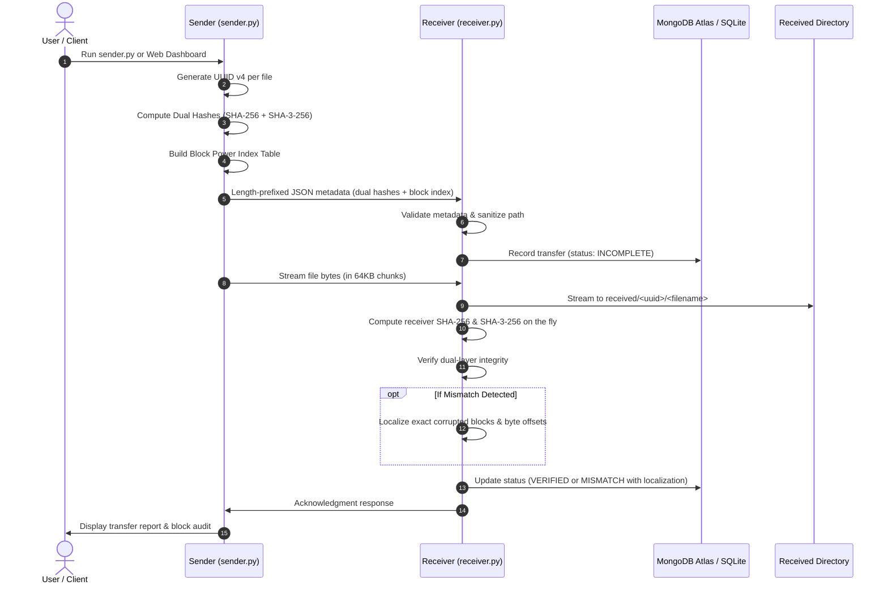

# Advanced Cryptographic Data Integrity Platform & Network File Transfer

> **Based on the Research Paper:**  
> *Chris Gilbert and Mercy Abiola Gilbert, “Exploring Secure Hashing Algorithms for Data Integrity Verification,” International Journal of Multidisciplinary Research and Publications (IJMRAP), Volume 7, Issue 11, pp. 373-390, 2025.*

An advanced Python TCP networking and web platform for secure, reliable file transfer with **Dual-Layer SHA-256 + SHA-3-256 verification**, **Block Power Indexing for fine-grained tamper localization** (Section 7.1), **Substring Index Tables**, **Avalanche Effect analysis** (Section II & IV), **MongoDB Atlas cloud storage**, and **UUID-based duplicate filename collision avoidance**.

---

## Architecture and Workflow



---

## Key Features & Research Contributions

1. **Dual-Layer Cryptographic Verification (SHA-256 + SHA-3-256)**:
   - Combines the industry-standard Merkle–Damgård construction (SHA-256) with the Keccak Permutation Sponge construction (SHA-3-256).
   - Provides defense against length-extension attacks and post-quantum threat vectors as advocated in the paper (Section 2.2 & VII).
2. **Block Power Indexing & Fine-Grained Tamper Localization (Section 7.1, RQ v)**:
   - Rather than binary pass/fail detection, files are partitioned into power-indexed blocks.
   - When corruption or tampering occurs, the engine pinpoints the **exact corrupted block number(s)**, **byte offset ranges**, and **percentage of altered data**.
3. **Substring Index Tables (Section 7.1)**:
   - Stores positional anchors for critical structural file headers, magic bytes, and markers for rapid localized verification.
4. **Strict Avalanche Criterion (SAC) & Bit Diffusion Lab (Section II & IV)**:
   - Evaluates the Avalanche Effect by flipping 1 bit in input data and measuring the Hamming distance bit divergence against the theoretical ~50% diffusion mark.
5. **Cryptographic Algorithm Benchmark (Table 3, Section IX)**:
   - Measures real-time throughput (MB/s) and latency on local hardware across MD5, SHA-1, SHA-256, SHA-512, and SHA-3-256, highlighting security vulnerabilities of deprecated algorithms.
6. **Duplicate Filename Strategy (UUID Directory Isolation)**:
   - Files are partitioned under `received/<uuid>/<original_filename>`.
   - Multiple transfers sharing the identical filename (e.g. `report.pdf`) never overwrite each other.
7. **Cloud & Local Storage Engine**:
   - Integrates with **MongoDB Atlas** (`cluster0.o9543g6.mongodb.net`) with seamless automatic fallback to local **SQLite** (`data/transfers.db`).

---

## Folder Structure

```
c:/Users/user/Downloads/hash_checker/
├── config.py                 # Central configuration and defaults
├── hash_utils.py             # Chunked SHA-256 calculation & incremental hasher
├── protocol.py               # Framing, recv_exact, JSON metadata, and path sanitization
├── storage.py                # SQLite database interface (data/transfers.db)
├── receiver.py               # TCP receiver server with auto-verification
├── sender.py                 # TCP client with streaming progress and hash computation
├── hash_checker.py           # CLI verification and audit utility
├── generate_certs.py         # Utility to generate self-signed TLS certificates
├── requirements.txt          # Python requirements / test dependencies
├── README.md                 # Project documentation
├── sender_files/             # Sample test files to send
├── received/                 # Received files isolated by UUID
├── data/                     # SQLite database (transfers.db) and TLS certs
├── logs/                     # System log file (transfer.log)
└── tests/                    # 22 automated unit and integration tests
```

---

## Installation & Requirements

The core application runs on Python 3.8+ using the standard library.

Install testing dependencies:
```bash
pip install -r requirements.txt
```

---

## Quickstart & CLI Usage

### Option A: Launch the Interactive Web Dashboard (Recommended)
Launch the modern browser interface with drag-and-drop file upload, live progress, real-time audit tables, and tamper testing:
```bash
python web_app.py
```
Open **`http://127.0.0.1:5000`** in your browser.

---

### Option B: Command Line (CLI) Workflow

#### 1. Start the Receiver Server
Listen on default host `127.0.0.1` and port `9999`:
```bash
python receiver.py
```
Options:
- `--host <ip>`: Bind IP (default: `127.0.0.1`)
- `--port <port>`: Port to listen on (default: `9999`)
- `--save-dir <path>`: Destination directory (default: `received`)
- `--token <token>`: Custom authentication token
- `--once`: Exit after receiving one transfer
- `--tls`: Enable TLS encryption (requires `--cert` and `--key`)

### 2. Send Files with Sender Client
Send a single file:
```bash
python sender.py sender_files/report.pdf
```

Send multiple files in batch:
```bash
python sender.py sender_files/notes.txt sender_files/report.pdf
```

Options:
- `--host <ip>`: Target host (default: `127.0.0.1`)
- `--port <port>`: Target port (default: `9999`)
- `--token <token>`: Authentication token
- `--tls`: Enable TLS encryption
- `--quiet`: Suppress progress output

### 3. Check and Audit Transfers with Hash Checker

**View transfer history:**
```bash
python hash_checker.py list
```

**Re-verify a received file by its Transfer ID:**
```bash
python hash_checker.py verify <transfer_id>
```

**Audit all received files on disk against their expected hashes:**
```bash
python hash_checker.py verify-all
```

**Calculate and verify hash of any local file:**
```bash
python hash_checker.py check-file <filepath> <expected_sha256>
```

---

## TLS Encrypted File Transfer

Generate self-signed certificate and private key:
```bash
python generate_certs.py
```

Run receiver with TLS:
```bash
python receiver.py --tls --cert data/server.crt --key data/server.key
```

Run sender with TLS:
```bash
python sender.py sender_files/report.pdf --tls --ca-cert data/server.crt
```

---

## Running the Automated Test Suite

Run the full pytest suite:
```bash
python -m pytest tests/ -v
```

All 22 test cases verify:
- Chunked hashing for empty, small, and multi-megabyte files
- Protocol framing, `recv_exact` stream fragmentation, and boundary tests
- Duplicate filename isolation under `received/<uuid>/<filename>`
- Normal end-to-end transfers with SHA-256 match
- Tampered/corrupted file detection (`MISMATCH`)
- Connection drops and partial transfer marking (`FAILED`)
- Directory traversal attacks and path sanitization
- Shared token authentication rejection
- File size limit enforcement
- TLS encrypted transfers
